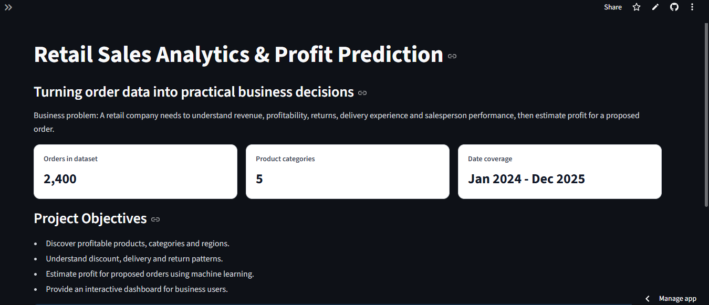
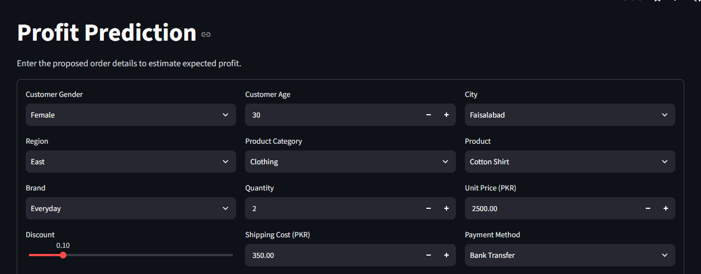
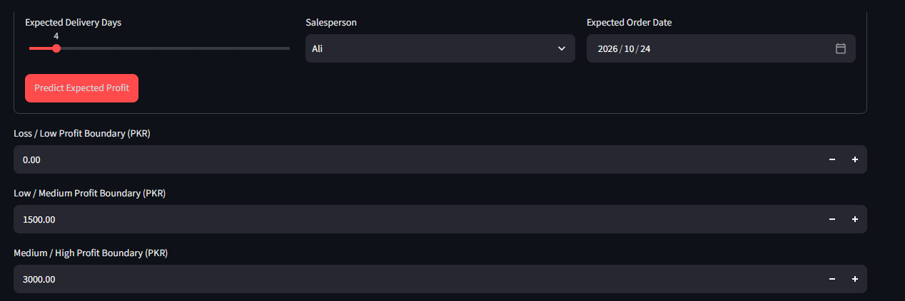
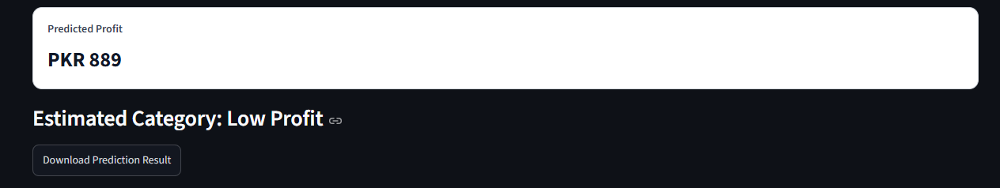
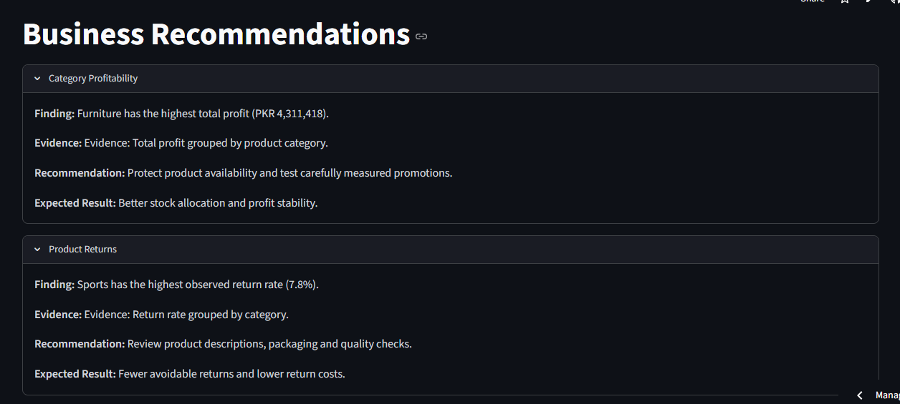
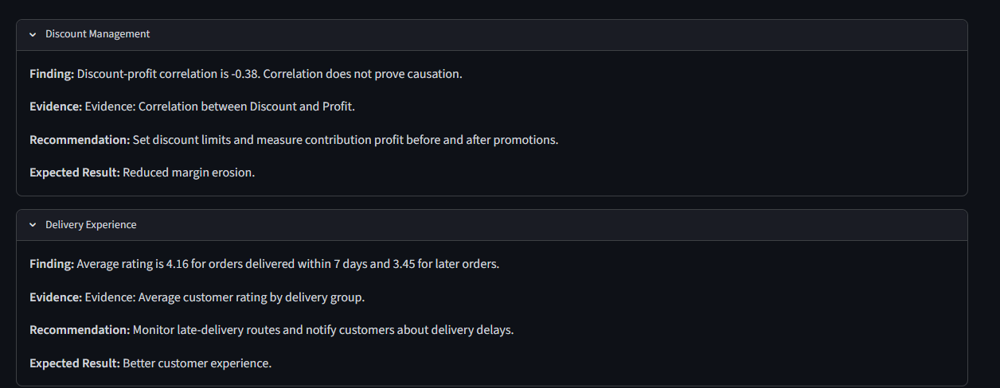
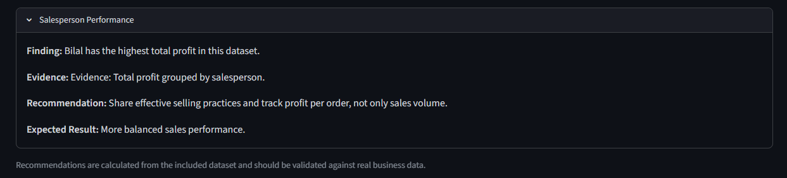

# Retail Sales Analytics & Profit Prediction

## Live Application

**[Open Live Streamlit Application](https://salesanalyticsprofitprediction-zuqkjcug4s3dxsw9w8ams9.streamlit.app/)**

## 1. Business Problem

Retail businesses need to understand sales, profit, product performance, regional performance, discounts, returns, delivery experience and salesperson performance. They also need a way to estimate the expected profit of a proposed order.

## 2. Project Objectives

- Analyze retail sales and profitability.
- Identify high-performing products and regions.
- Understand customer and delivery patterns.
- Evaluate discount and return trends.
- Train machine-learning models to predict profit.
- Provide actionable business recommendations.

## 3. Dataset Description

The project uses `data/dataset.csv`, containing 2,401 generated order records.

The dataset includes customer, product, sales, discount, shipping, payment, delivery and order-date information.

**Note:** This is a synthetic teaching dataset, not real company data.

## 4. Tools and Technologies

- Python
- Pandas and NumPy
- Matplotlib, Seaborn and Plotly
- Scikit-learn
- Joblib
- Streamlit
- Jupyter Notebook
- Git and GitHub
- Docker
- Pytest

## 5. Data Cleaning

- Converted order dates into datetime format.
- Checked and removed duplicate records.
- Converted numeric columns into appropriate data types.
- Checked missing values.
- Used imputation inside machine-learning pipelines.
- Investigated unusual values.
- Prepared data for analysis and model training.

## 6. Exploratory Data Analysis (EDA)

The project explores:

- Sales and profit trends.
- Product and category profitability.
- Regional performance.
- Customer demographics.
- Discounts and returns.
- Delivery performance.
- Payment methods.
- Salesperson performance.

## 7. Feature Engineering

The project creates additional features, including:

- Order year and month.
- Quarter.
- Month and day names.
- Customer age groups.
- Profit margin.
- Discount amount.
- Revenue before discount.
- Delivery status.
- Order-size category.

## 8. Machine Learning Models

Three regression models were trained and compared:

1. Linear Regression
2. Decision Tree Regressor
3. Random Forest Regressor

## 9. Model Evaluation Results

The models were evaluated using MAE, MSE, RMSE and R².

| Model | MAE | RMSE | R² |
|---|---:|---:|---:|
| Random Forest | 1,417.59 | 2,443.81 | 0.8924 |
| Decision Tree | 1,977.61 | 3,263.48 | 0.8082 |
| Linear Regression | 2,921.48 | 4,397.18 | 0.6518 |

## 10. Best Model

**Random Forest Regressor** was selected as the best-performing model because it achieved the lowest RMSE and highest R² among the three tested models.

The saved model pipeline is available at:

`models/final_pipeline.pkl`

## 11. Streamlit Application Features

The application contains eight sections:

1. Home
2. Dataset Explorer
3. Sales Dashboard
4. Product & Regional Analysis
5. Customer & Delivery Analysis
6. Model Evaluation
7. Profit Prediction
8. Business Recommendations

Additional features include interactive charts, advanced filters, downloadable datasets and prediction results.

## 12. Business Recommendations

The application provides recommendations related to:

- Category profitability.
- Product returns.
- Discount management.
- Delivery experience.
- Salesperson performance.

These recommendations should be validated using real business data before making actual business decisions.

## 13. Run the Application Locally

Clone the repository:

```bash
git clone https://github.com/mfarzam2010-jpg/Sales_Analytics_Profit_Prediction.git
```

Open the project folder:

```bash
cd Sales_Analytics_Profit_Prediction
```

Create a virtual environment:

```bash
python -m venv venv
```

Activate it on Windows:

```bash
venv\Scripts\activate
```

Install the required libraries:

```bash
pip install -r requirements.txt
```

Run the Streamlit application:

```bash
streamlit run app.py
```

## 14. Streamlit Deployment

The application is deployed using Streamlit Community Cloud.

**Live Application:**

https://salesanalyticsprofitprediction-zuqkjcug4s3dxsw9w8ams9.streamlit.app/

## 15. Screenshots

## 15. Application Screenshots

### Home Page


### Application Screenshots
.png)
.png)
.png)
.png)
.png)
.png)
.png)
.png)
.png)
.png)

### Additional Screenshots
.png)
.png)
.png)
.png)
.png)
.png)

### Profit Prediction








## 16. GitHub Repository

[View Source Code on GitHub](https://github.com/mfarzam2010-jpg/Sales_Analytics_Profit_Prediction)

## 17. Project Files

- `app.py` — Main Streamlit application.
- `data/` — Dataset.
- `models/` — Saved machine-learning models.
- `notebooks/` — Jupyter notebook.
- `pages/` — Supporting project pages.
- `reports/` — Model metrics and business reports.
- `tests/` — Automated tests.
- `utils/` — Utility and preprocessing modules.
- `requirements.txt` — Project dependencies.
- `.gitignore` — Files excluded from Git.

---

**Project:** Retail Sales Analytics & Profit Prediction  
**Deployment:** Streamlit Community Cloud  
**Source Code:** GitHub
